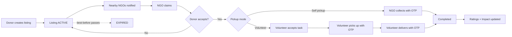
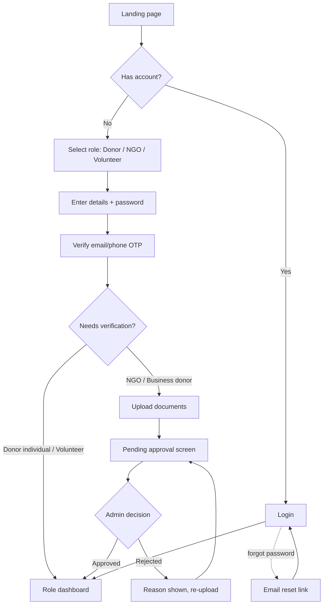
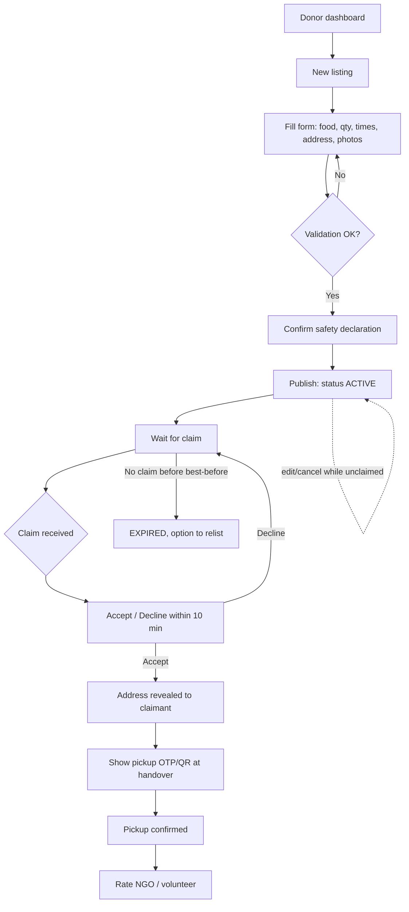
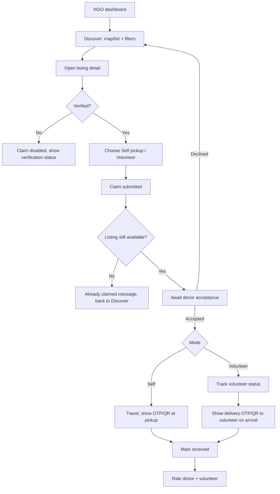
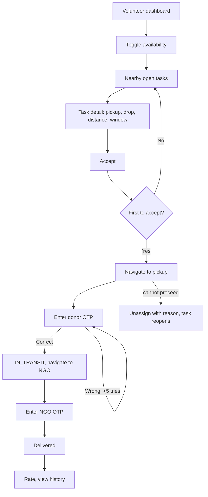
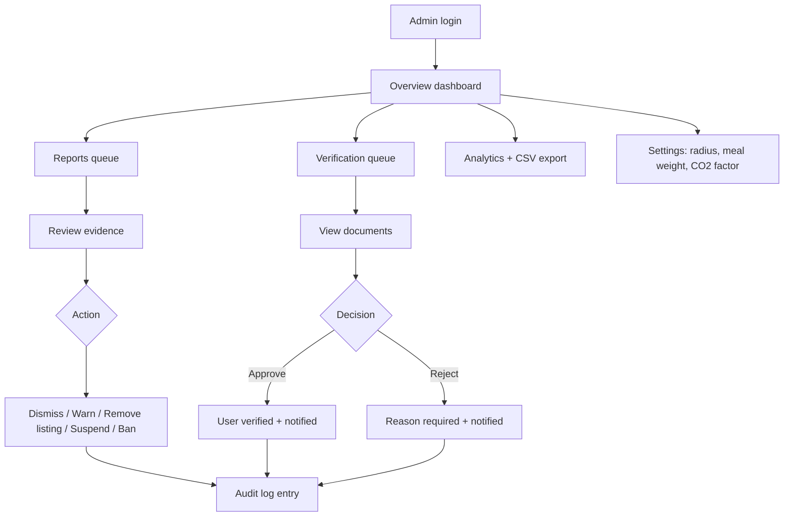
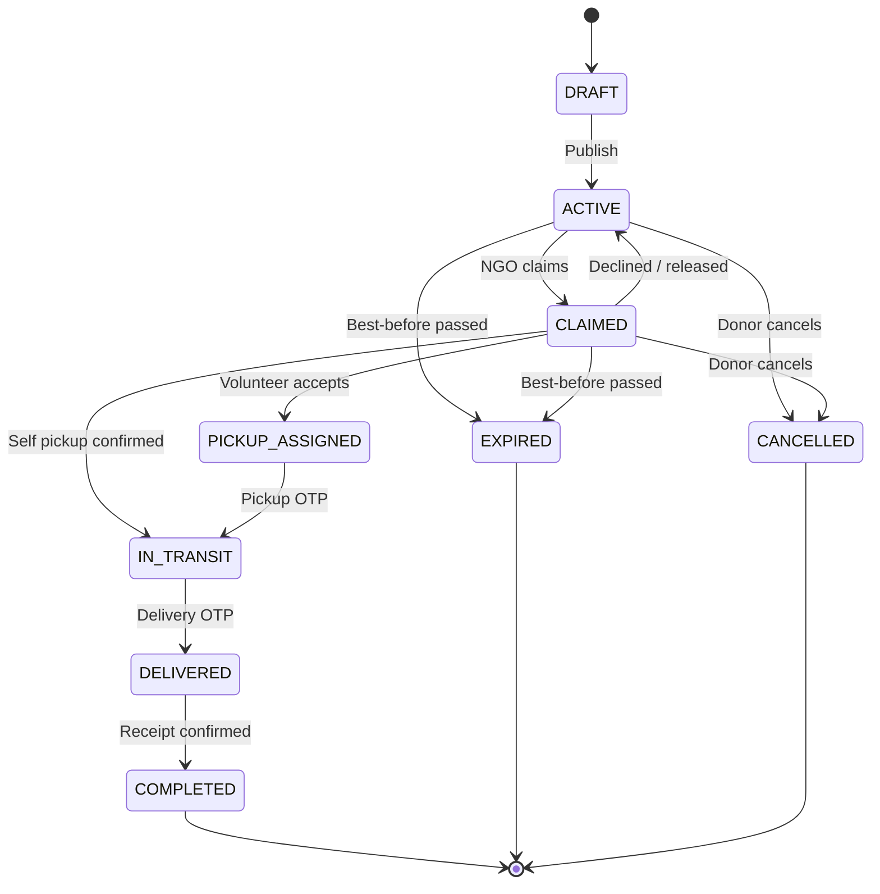

# App Flow Document
## Food Rescue: Food Donation & Redistribution Management System

| Field | Value |
|---|---|
| Version | 1.0 (Draft) |
| Date | 18 October 2026 |

This document describes how each user moves through the application, including decisions, system actions and edge cases. Diagrams use Mermaid (renders on GitHub, VS Code and most Markdown viewers).

---

## 1. Global Flow (End-to-End)

---

## 2. Entry and Onboarding Flow

**Rules**
- Login blocked until contact verification is done.
- Unverified NGOs can browse but see "Claim" disabled with a reason.
- 5 failed logins lock the account for 15 minutes.

---

## 3. Donor Flow

**Screens:** Dashboard → Create Listing → My Listings → Listing Detail/Tracking → Rate → Impact.

**Edge cases**
- Edit locked after a claim exists; donor must cancel instead (with reason) which notifies the NGO.
- Donor ignores a claim: auto-accepted after the timeout.
- Donor cancels after volunteer assigned: volunteer and NGO notified immediately.

---

## 4. NGO Flow

**Edge cases**
- NGO may release a claim before pickup; listing returns to ACTIVE if time remains.
- No volunteer accepts within 15 minutes: prompt NGO to switch to self-pickup or widen radius.
- Quality issue on arrival: "Report a problem" with photo, flagged to admin.

---

## 5. Volunteer Flow

---

## 6. Admin Flow

---

## 7. Listing Status Lifecycle

---

## 8. Notification Triggers

| Event | Recipient | Channels |
|---|---|---|
| New listing near NGO | NGOs in radius | In-app, email (optional push later) |
| Claim submitted | Donor | In-app, email |
| Claim accepted/declined | NGO | In-app, email |
| Task available | Volunteers in radius | In-app, SMS (optional) |
| Volunteer assigned | Donor, NGO | In-app, email |
| Pickup confirmed / Delivered | Donor, NGO | In-app |
| Expiring in 30 min, unclaimed/unpicked | Donor, NGO | In-app, SMS |
| Verification approved/rejected | User | In-app, email |
| Report outcome | Reporter, reported user | In-app, email |

---

## 9. Error and Exception Flows

| Situation | System Behaviour |
|---|---|
| Two NGOs claim simultaneously | One succeeds; other sees "Already claimed" and returns to feed |
| Best-before passes mid-flow | Flow halted, parties notified, status EXPIRED |
| Wrong OTP 5 times | Handover locked 10 min, admin visible in log |
| Token expired | Silent refresh; if it fails, redirect to login and return to prior page |
| Location permission denied | Prompt manual address/pincode entry |
| Offline / poor network | Show cached last list, retry banner, queue non-critical actions |
| Image upload fails | Retry, allow publishing with at least one photo uploaded |
| Suspended user | Login shows reason and appeal contact |

---

## 10. Route Map (Frontend)

| Route | Access |
|---|---|
| `/` , `/how-it-works`, `/impact` | Public |
| `/login`, `/register`, `/verify`, `/forgot-password` | Public |
| `/donor/dashboard`, `/donor/listings/new`, `/donor/listings/:id` | Donor |
| `/ngo/discover`, `/ngo/listings/:id`, `/ngo/claims/:id` | NGO |
| `/volunteer/tasks`, `/volunteer/tasks/:id` | Volunteer |
| `/notifications`, `/profile`, `/impact/me` | Authenticated |
| `/admin/*` (overview, verifications, users, listings, reports, analytics, settings, audit) | Admin |

Unauthorised access redirects to login; wrong-role access shows a 403 page.
